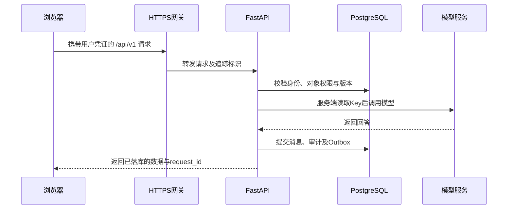

# 部署问题修复与生产完善方案

> 实施状态：本方案的代码修复、隔离预发布部署和主要验收已完成。当前 `172.22.3.76:189` 是内网预发布入口，不等同于正式生产；正式 HTTPS、支付签约、邮件通道、受支持的 PostgreSQL 版本及多节点容灾仍是上线门禁。详细变更和证据见 [`实施与验证报告.md`](./实施与验证报告.md)。

编写日期：2026-10-16。适用项目：`/home/lawsft/legal-service-hub`。

本文是实施与验收文档。文中的“新增”“改造”“目标接口”和代码片段均属于待实施方案，不表示相应功能已经上线。执行命令前，应先完成对应代码修改，并按文中标明的环境进行操作。

## 0. 当前基线与实施顺序

### 0.1 核对结果

| 级别 | 问题 | 当前实际状态 | 完成标准 |
| --- | --- | --- | --- |
| 高危 | 前端未接入后端 | `app.js` 调用本地 `dispatch` 并写入 localStorage；Node 服务仅提供静态文件 | 浏览器操作经过认证 API，业务状态从服务端读取，刷新和换设备后保持一致 |
| 高危 | 支付回调无签名认证 | 已检查渠道一致性，但仍接收未经验签的 `PaymentWebhook`；支付适配器仅支持 `stub` | 实际支付产品完成签约；验签、解密、幂等记账、主动查单和退款验证通过 |
| 高危 | 服务用户无法读取模型 Key | Key 为 `root:root 600`；当前主机尚无 `legal-api` 用户；服务模板仍使用 `/opt/...` | 以最终服务用户、最终 systemd 沙箱运行时可读 Key，并成功调用真实模型 |
| 中危 | 就绪检查只查数据库 | `/health/ready` 仅执行 `SELECT 1` | 返回数据库、Redis、模型、存储各自状态；故障按依赖策略摘流或降级 |
| 中危 | 律师注册缺少入口 | 注册固定产生 `client`，资质申请却要求已有 `lawyer` 身份 | 普通账户能申请律师资质；只有审核通过才获得报价权限 |

本机 systemd 实测版本为 239，`setfacl` 可用。本文默认 API 仍在本服务器运行，模型服务为 `http://172.22.3.76:180/v1`，模型为 `Qwen3.8-27B`；生产前端使用正式 HTTPS 域名，内网 `:189` 保留为联调入口。

### 0.2 交付顺序

1. 先完成密钥授权、生产配置和依赖探针，形成稳定 API 运行环境。
2. 完成账户与律师申请流程，移除前端本地角色模拟，再接咨询、需求、报价、订单、文书等 API。
3. 同步申请支付产品；取得商户配置后实施支付与退款适配器。签约完成前关闭生产收款入口。
4. 在独立预发布数据库进行浏览器 E2E、真实模型联调、支付联调和故障注入。
5. 按第 6 节验收后再逐步开放生产流量。

现有后端测试会执行 `drop_all()` 重建数据，必须显式指向一次性测试库。原测试中的 `setdefault("DATABASE_URL", ...)` 不会覆盖外部已有连接串，不能直接在生产服务环境中执行。

## 1. 高危：前端未接入后端

### 1.1 问题分析

入口在 [app.js](app.js)、[model-consultation.js](model-consultation.js) 和 [business.js](business.js)。浏览器内的业务对象、角色、支付状态及模型回答均不能作为服务端事实来源。仅修改页面提示文字或替换模型回答函数，无法解决订单不落库、换设备丢失及权限可绕过的问题。

当前 [server.mjs](server.mjs) 只支持静态 GET/HEAD，不代理 API。其静态根目录还是整个仓库；增加后端后，生产静态站点必须改用只包含公开资源的发布目录，避免 `/backend/data/...` 等路径被下载。

目标链路如下：



### 1.2 实施步骤

**步骤一：建立同源网关。**

生产使用 `https://legal.example.com`，浏览器只访问该域名。Nginx 将 `/api/v1/` 转发至 `127.0.0.1:8000`，静态资源放到 `/var/www/legal-service-hub`，不要把仓库根目录作为站点目录。API 端口与模型端口只向必要的内网来源开放。

以下为待替换域名和证书路径的 Nginx 配置片段；80 端口跳转 HTTPS 在站点配置中另行设置：

```nginx
server {
    listen 443 ssl;
    server_name legal.example.com;
    ssl_certificate /etc/nginx/tls/legal.example.com.fullchain.pem;
    ssl_certificate_key /etc/nginx/tls/legal.example.com.key;
    root /var/www/legal-service-hub;
    index index.html;
    client_max_body_size 55m;

    location /api/v1/ {
        proxy_pass http://127.0.0.1:8000;
        proxy_set_header Host $host;
        proxy_set_header X-Forwarded-Proto $scheme;
        proxy_set_header X-Forwarded-For $remote_addr;
        proxy_read_timeout 120s;
    }

    location /health/ {
        allow 127.0.0.1;
        deny all;
        proxy_pass http://127.0.0.1:8000;
    }

    location / {
        try_files $uri $uri/ =404;
    }
}
```

发布目录只复制 `index.html`、页面依赖的 JS/CSS 和公开资产。模型 Key、`.env`、数据库、上传目录和后端代码不得进入该目录。55 MiB 的请求体上限为 50 MiB 文件预留 multipart 开销；应用仍检查文件本身大小。

API 使用 `--proxy-headers --forwarded-allow-ips 127.0.0.1`，只信任实际网关；多级网关场景显式配置可信代理链。同步调整 `main.py` 限流键，避免所有请求因代理共用一个源 IP 被集中限流。支付回调使用独立入口配额和验签策略，不能套用单一用户配额。

联调若前端仍在 `http://172.22.3.76:189`，可暂时使用 API 基地址加精确 CORS 白名单；生产恢复同源。禁止使用 `allow_origins=["*"]` 配合携带 Cookie 的跨域请求。

**步骤二：用真实认证代替角色选择器。**

- 登录调用现有 `POST /api/v1/auth/login`，随后调用 `GET /api/v1/auth/me` 获取身份。UI 根据服务端权限展示菜单，不能靠修改 `ROLE_KEY` 获取权限。
- 第一阶段保持现有 Bearer Token 契约，Access Token 仅放内存；过期后重新登录，保留当前尚未提交的输入。每个对象在后端重新鉴权。
- 需要长期登录时，再新增 `POST /auth/refresh`、`POST /auth/logout`、刷新会话表和轮换机制。Refresh Token 使用 `Secure; HttpOnly; SameSite=Lax` Cookie，校验 Origin/CSRF，并支持撤销；这些接口当前尚不存在。
- localStorage 仅保存主题等界面偏好。旧演示数据不自动写回生产库；用户确认后通过专门迁移入口导入，服务端重校验全部权限、金额和状态。

**步骤三：新增统一 API 客户端。**

新增 `api-client.js` 和 `auth-state.js`。请求携带 `Authorization`、必要的 `Idempotency-Key`，统一处理超时、401、403、409、422、429、503。现有错误既可能位于 `error`，也可能位于 `detail`；先兼容两种格式，再统一后端错误契约。下面是 API 客户端的核心示例：

```javascript
import { getAccessToken } from "./auth-state.js";

export async function apiRequest(endpoint, options = {}) {
  const controller = new AbortController();
  const timeout = setTimeout(() => controller.abort(), options.timeoutMs ?? 110000);
  const headers = { Accept: "application/json" };
  const token = getAccessToken();
  if (token) headers.Authorization = `Bearer ${token}`;
  if (options.idempotencyKey) headers["Idempotency-Key"] = options.idempotencyKey;
  const multipart = options.body instanceof FormData;
  if (options.body !== undefined && !multipart) headers["Content-Type"] = "application/json";
  try {
    const response = await fetch(`/api/v1${endpoint}`, {
      method: options.method ?? "GET",
      headers,
      body: options.body === undefined ? undefined : multipart ? options.body : JSON.stringify(options.body),
      credentials: "same-origin",
      signal: controller.signal,
    });
    const payload = response.status === 204 ? null : await response.json();
    if (!response.ok) {
      const detail = payload?.error ?? payload?.detail;
      const error = new Error(detail?.message ?? "请求失败，请稍后重试");
      error.status = response.status;
      error.requestId = response.headers.get("X-Request-Id");
      throw error;
    }
    return payload;
  } finally {
    clearTimeout(timeout);
  }
}
```

生产实现还应把网络错误、AbortError 和非 JSON 网关错误转换成中文提示。仅 GET 可自动进行有限重试；业务 POST 不因浏览器超时自动重发。超时只表示浏览器停止等待，不能认定服务器已回滚，应查询服务器状态或使用同一幂等键重试。

**步骤四：逐模块替换本地命令。**

下表均以 `/api/v1` 为前缀；除特别注明外，接口当前已存在：

| 页面/动作 | API 衔接 | 前端改造要点 |
| --- | --- | --- |
| 新建、回看咨询 | `POST /consultations`，`GET /consultations`，`GET /consultations/{id}` | 使用后端 ID；列表和详情从服务端获取 |
| 发送咨询、连续追问 | `POST /consultations/{id}/messages` | `prompt`、`topic`、`context_enabled`；等待后端返回消息列表后更新页面 |
| 回答评价 | `POST /consultations/{id}/feedback` | 传后端 `message_id`，不再传本地消息数组下标 |
| 咨询转服务需求 | 先 `POST /consultations/{id}/summary`，再 `POST /requests` | 明确同意后传 `consent=true`、`source_consultation_id`；摘要快照与同意记录绑定 |
| 需求列表、详情 | `GET /requests`，`GET /requests/{id}` | 服务端过滤可见性；页面不再自行判断对象所有权 |
| 律师列表与报价 | `GET /lawyers`，`POST /requests/{id}/quotes`，`GET /requests/{id}/quotes` | 律师资格、有效期与报价有效期由服务端检查 |
| 接受报价 | `POST /quotes/{id}/accept` | 一次用户意图产生一个 UUID 幂等键，重试沿用该键 |
| 订单与付款 | `GET /orders`、`GET /orders/{id}`、`POST /orders/{id}/payments` | 显示实际支付渠道参数；支付结果从订单查询获取 |
| 文书与版本 | `GET/POST /documents`、`GET /documents/{id}`、`POST /documents/{id}/versions` | `base_version` 来自最新版本；409 时保留草稿并提示刷新 |
| 会签、批注、授权 | `/documents/{id}/workflow`、`/workflow/confirm`、`/workflow/return`、`/comments`、`/access/{member_id}/revoke` | 调用现有对应 POST 路由，使用服务端版本与状态 |
| 交付与收悉 | `POST /orders/{id}/deliveries`、`POST /orders/{id}/receipt?accepted=true` | 交付物属于当前订单；退回必须填写原因 |
| 售后与运营处理 | `POST /orders/{id}/after-sales`、`GET /admin/cases`、`POST /admin/cases/{id}/resolve` | 前端只显示后端决定的状态，不能本地修改已付或已退款金额 |
| 通知与已读 | `GET /notifications`、`POST /notifications/{id}/read` | 使用服务端通知 ID |
| 材料上传/下载 | `POST /files`、`GET /files/{id}` | multipart 上传；受保护下载使用 Bearer fetch 后生成短期 Blob URL |

`model-consultation.js` 的 `send()` 改为异步：保存输入 → 必要时创建咨询 → 提交消息 → 显示返回的用户消息与回答。请求期间禁用重复提交并显示等待状态；失败保留输入，不能生成示例回答冒充真实结果。移除“本地示例”标签时增加数据来源字段，历史演示记录仍标记为示例。

咨询历史传输应保留 user/assistant 角色并限制总 Token，不能将任意用户历史直接拼入高优先级 system 指令。服务端对同一咨询的消息序号和并行写入做串行化或乐观版本控制，避免两次追问顺序混乱。

文件上传目前只具备保存与授权能力，不等于模型能够阅读 PDF/Word/图片。第一阶段页面明确材料尚未用于回答；需要材料分析时，新增异步解析/OCR、脱敏及检索适配器，仅接受当前用户有权访问且解析成功的 `file_id`。没有 `document_id` 的咨询材料也需新增与咨询的关联和所有权校验，不能只信任客户端传来的文件名。

**步骤五：补齐服务端持久化契约。**

- 所有写操作以数据库事务为准：业务对象、审计、Outbox 和幂等记录共同提交。当前服务内部先 `commit()`、路由再保存幂等记录的做法需要合并事务边界，避免提交与记幂等之间崩溃。
- 幂等记录按用户、HTTP 方法、业务路由、幂等键建立唯一约束，保存规范化请求摘要。并发插入冲突后读取已提交结果，不能吞掉 IntegrityError 并返回虚假的成功。
- 文书版本、支付、会签等冲突返回明确的 409；金额返回定点十进制字符串或整数分，避免 JS 浮点记账。
- 创建需求、咨询消息、交付、退款等可能重复提交的操作补充幂等支持；当前不能假定所有 POST 已实现幂等。
- 咨询消息排序增加稳定的单调序号；授权摘要保存不可变快照及版本，防止新回答覆盖旧授权内容。
- 列表补分页、查询上限及索引，避免历史消息、文书版本和订单全表读拖垮接口。

### 1.3 代码修改点

| 路径 | 改造内容 |
| --- | --- |
| `app.js` | 真实登录态、服务端列表加载、移除本地业务 `commit/run` 入口 |
| `model-consultation.js` | 异步咨询、后端消息 ID、失败重试提示、真实来源标签 |
| `business.js` | 仅留纯展示计算和独立 Demo 模式；生产流程移到 Python 服务 |
| 新增 `api-client.js`、`auth-state.js` | 请求、Token 内存态、错误处理、超时与幂等键 |
| `backend/app/api/serializers.py`、`schemas.py` | 统一字段、金额、来源、消息序号、分页及错误响应契约 |
| `backend/app/core/idempotency.py`、相关 services/api | 统一事务和幂等；当前对象级权限继续在服务端执行 |
| 网关配置、`server.mjs`、部署脚本 | 同源转发、可信代理、独立静态发布目录 |

### 1.4 验证方式

新增真正的浏览器 E2E，建议采用 Playwright；浏览器不得拦截业务 API 返回假数据。使用隔离的预发布 PostgreSQL 和三个独立账户，执行：

1. 登录 → 发起真实模型咨询 → 连续追问 → 反馈 → 明确授权 → 发布需求。
2. 律师登录 → 看见需求 → 报价 → 当事人接受 → 查询自动生成的订单和服务合同。
3. 沙箱/受控测试付款 → 查询到账 → 文书修订与会签 → 上传 → 交付 → 收悉 → 退款处理。
4. 每次写入都在独立数据库会话核对对象 ID、所属用户、状态、金额、审计和 Outbox；刷新页面及新浏览器登录后仍能读取相同结果。
5. 篡改 localStorage 角色、其他用户 ID、报价金额和文书版本，确认拒绝且数据库无变化。
6. 模拟网络超时、401、409、429、模型 503 和双击提交，确认不丢草稿、不重复下单、不伪造回答。
7. 请求静态域名的 `/.env`、`/backend/data/legal_service.db`、`/backend/app/main.py`，应返回 403/404。

## 2. 高危：支付回调缺少签名认证

### 2.1 问题分析与产品选择

回调是支付平台向后端发起的服务器请求，不会携带本站用户 JWT。正确做法是使用支付平台签名认证来源，而不是要求回调登录。

现有 `payment_provider.py` 仅能创建 Stub 意图，现有 JSON `PaymentWebhook` 是内部测试格式，并非微信或支付宝真实回调协议。生产必须关闭 `stub` 下单和回调；未知渠道返回明确 4xx，不应触发 ValueError 变成 500。

建议按以下业务场景申请产品。PC 扫码可优先接微信 Native；微信内网页再增加 JSAPI。官方 PC 接入页面同时说明了申请与 AppID 绑定要求。[微信支付 PC 网站接入指引](https://pay.wechatpay.cn/static/applyment_guide/applyment_detail_website.shtml)

| 场景 | 需注册/开通的产品 | 对本项目的影响 |
| --- | --- | --- |
| PC 网站展示支付二维码 | 微信支付商户号 + Native 支付 | 后端下单返回 `code_url`，前端展示二维码 |
| 微信内打开网页 | 微信支付商户号 + JSAPI 支付，并具备对应公众号 AppID | 需要网页授权、openid、支付授权目录及 AppID 绑定 |
| 普通浏览器跳转支付宝收银台 | 支付宝商家主体与开放平台网页应用，申请电脑网站支付；移动网页按产品申请手机网站支付 | 使用对应支付 API、应用密钥/证书及异步通知地址 |
| 撮合法律服务，并向独立律所分账/结算 | 先向支付机构确认适配该法律服务行业的平台收款、子商户或分账方案 | 核实经营主体、实际服务方、退款责任及结算安排后再确定 API |

支付宝签约应按实际 PC/手机网页场景选择产品，可从官方商家中心办理。[支付宝网页收款产品入口](https://b.alipay.com/signing/productScene.htm?navKey=wysk&sceneId=wysk)

平台收款模式需要单独审核，不能默认法律服务平台一定适用电商产品。微信平台收付通有自己的经营场景与准入条件，需将本项目的真实资金流提交支付机构确认。数据库中的 `frozen` 只是业务状态，不代表支付机构已经冻结或托管资金。[平台收付通官方介绍](https://pay.wechatpay.cn/static/partner_ability/business_payment.shtml)

### 2.2 您需要准备的资料与配置

以下是项目方交接清单；最终以选定产品和商户后台审核清单为准，不预设费率或审批时限。

| 类别 | 需要准备的内容 | 交接方式 |
| --- | --- | --- |
| 签约主体 | 企业/律所等主体的营业执照或依法登记证照、统一社会信用代码、经营范围与法律服务相关资质 | 在支付平台的官方入驻入口提交 |
| 负责人 | 法定代表人或负责人身份证明、经办人授权材料、管理员手机号和邮箱 | 按主体类型提交；不要写进 Git 或普通工单 |
| 结算 | 与主体匹配的结算账户、开户行资料、账户验证；平台场景补服务方资料 | 完成官方账户验证，确认谁收款、谁退款、谁开发票 |
| 业务说明 | 法律服务目录、定价、服务协议、退款/投诉流程、真实交易页面及经营类目 | 供平台审核，也用于内部资金流程确认 |
| 网络 | 归属明确的正式域名、有效 HTTPS 证书、公网 443 回调入口；按产品要求提供网站备案/许可 | 当前 `172.22.3.76` 是内网地址，支付平台无法直接回调 |
| 微信参数 | `mchid`、场景对应 `appid`、商户 API 私钥和证书序列号、APIv3 Key、微信支付公钥及其 ID 或受信平台证书 | 私钥和 APIv3 Key 存入服务器密钥目录，仅交接文件路径 |
| 支付宝参数 | `app_id`、收款方 `seller_id`、应用私钥、支付宝公钥；证书模式另备应用/支付宝/根证书及序列号 | 开发与生产分开配置；确认签约产品已生效 |
| 环境 | 支付宝沙箱账户和应用；微信依具体产品联调工具或获准的小额真实测试 | 不假定微信存在所有产品通用沙箱 |

JSAPI 的 AppID、网页授权、openid 和支付目录应按官方开发流程配置；本站前端不能持有公众号 Secret。[微信 JSAPI 开发指引](https://pay.wechatpay.cn/doc/v3/merchant/4012791870)

下面是拟新增的配置示例；其中占位值必须替换，不能原样用于生产：

```dotenv
PAYMENT_PROVIDER=wechatpay
PAYMENT_STUB_ENABLED=false
WECHATPAY_MCH_ID=<商户号>
WECHATPAY_APP_ID=<已绑定的AppID>
WECHATPAY_MCH_SERIAL_NO=<商户证书序列号>
WECHATPAY_PRIVATE_KEY_FILE=/etc/legal-service-hub/secrets/wechatpay-private.pem
WECHATPAY_API_V3_KEY_FILE=/etc/legal-service-hub/secrets/wechatpay-api-v3-key
WECHATPAY_VERIFY_KEYS_DIR=/etc/legal-service-hub/payment-public-keys
WECHATPAY_NOTIFY_URL=https://legal.example.com/api/v1/payments/webhooks/wechatpay
PAYMENT_TIMESTAMP_TOLERANCE_SECONDS=300
ALIPAY_APP_ID=<应用ID>
ALIPAY_SELLER_ID=<实际收款方ID>
ALIPAY_PRIVATE_KEY_FILE=/etc/legal-service-hub/secrets/alipay-private.pem
ALIPAY_PUBLIC_KEY_FILE=/etc/legal-service-hub/payment-public-keys/alipay-public.pem
ALIPAY_NOTIFY_URL=https://legal.example.com/api/v1/payments/webhooks/alipay
```

### 2.3 回调验签、时间戳与重放保护

**第一层：按渠道读取并验证原始请求。**

微信路由改为接收 FastAPI `Request`，先获取原始 body 与签名头，不能先转换为本站 `PaymentWebhook`。按 `Wechatpay-Serial` 从受信密钥映射选择微信公钥或平台证书，用时间戳、Nonce 和原始 body 构造带末尾换行的验签串，执行 RSA-SHA256 验签。不能使用商户自己的公钥验证微信签名，也不能下载回调指定的任意密钥 URL。[微信公钥验签规则](https://pay.wechatpay.cn/doc/v3/merchant/4013053249)

以下为待新增 `core/payment_security.py` 的验签核心示例，依赖 `cryptography`；它只展示验签，解密、商户校验和持久化仍需按后文实现：

```python
import base64
from collections.abc import Mapping

from cryptography.exceptions import InvalidSignature
from cryptography.hazmat.primitives import hashes
from cryptography.hazmat.primitives.asymmetric import padding

from app.core.errors import DomainError


def verify_wechat_signature(raw_body: bytes, headers: Mapping, trusted_keys: Mapping, now: int):
    try:
        timestamp_text = headers["Wechatpay-Timestamp"]
        nonce = headers["Wechatpay-Nonce"]
        serial = headers["Wechatpay-Serial"]
        if abs(now - int(timestamp_text)) > 300:
            raise ValueError("expired timestamp")
        if not nonce or len(nonce) > 128:
            raise ValueError("invalid nonce")
        public_key = trusted_keys[serial]
        signature = base64.b64decode(headers["Wechatpay-Signature"], validate=True)
        signed_message = timestamp_text.encode("ascii") + b"\n" + nonce.encode("ascii") + b"\n" + raw_body + b"\n"
        public_key.verify(signature, signed_message, padding.PKCS1v15(), hashes.SHA256())
    except (KeyError, ValueError, UnicodeError, InvalidSignature) as exc:
        raise DomainError("支付通知认证失败", 401, "invalid_payment_signature") from exc
```

`trusted_keys` 必须是应用启动/受信刷新过程加载的 RSA 公钥对象；若使用平台证书，先验证信任来源和有效期，再提取公钥。新旧验证密钥按官方轮换期并存，未知序列号暂拒并触发受限刷新，禁止每个恶意请求都触发外部下载。

微信时间戳允许与服务器时间最大偏差 300 秒，同时拒绝明显未来时间；采用 NTP/chrony 同步系统时钟。微信重试会重新生成时间戳与签名，不要按订单创建时间执行 5 分钟过滤。[微信平台证书验签与时间校验](https://pay.wechatpay.cn/doc/v3/merchant/4013053420)

微信验签后才解析 JSON，检查加密算法，并用 APIv3 Key 对 `resource` 执行 AES-256-GCM 认证解密。APIv3 Key 是解密用途，不是回调 RSA 验签密钥。验证成功后从解密内容提取商户号、AppID、商户订单号、平台交易号、币种、总金额和交易状态。微信收到成功通知的应答应为 HTTP 200/204；本项目采用无 body 的 204，持久化接收需要在官方通知响应时限内完成。[微信支付成功通知、解密与应答](https://pay.wechatpay.cn/doc/v3/merchant/4012791861)

支付宝使用表单通知：按其所选产品的规范解析、排除 `sign` 与 `sign_type` 后生成规范验签参数，要求 RSA2，并用支付宝公钥/对应证书核验。保留协议规定的全部参与验签字段，拒绝重复歧义字段，不把表单转成微信格式。可基于[支付宝官方 Python SDK](https://github.com/alipay/alipay-sdk-python-all)的对应版本适配。

支付宝的 `notify_time` 与微信请求签名时间戳含义不同，不能简单统一为“超过 5 分钟一律丢弃”。检查时间格式、时区和异常未来值；对于超过产品正常重试周期的通知，进入异常队列并主动查单确认。合法延迟通知仍通过事件唯一约束与交易状态防重，不能因延迟让真实支付永久漏记。成功应答使用纯文本 `success`，不是 JSON 字符串或 HTML。[支付宝异步通知说明](https://global.alipay.com/developer/helpcenter/detail?_route=sg&categoryId=67617&knowId=201602452303&sceneCode=AC_DEV)

**第二层：商户、订单、金额和状态校验。**

渠道必须匹配服务端支付单；商户/AppID/收款方必须属于本站配置。查找服务端事先生成的商户支付单号，核对币种、订单应付金额及支付金额。微信金额以整数分处理，支付宝金额用 Decimal，不能用前端回传金额记账。只将官方已支付状态归一为内部成功；退款成功和交易关闭有独立状态转换。

**第三层：数据库持久化防重。**

新增 `PaymentWebhookInbox`，至少包含 `provider`、`merchant_id`、`event_id`、原始报文摘要、认证结果、标准化事件、处理状态、尝试次数和时间戳，唯一约束为 `(provider, merchant_id, event_id)`。敏感原始报文如需排查应加密保存并设置保留期，日志只记录脱敏摘要。

接收流程为：限流及 body 大小检查 → 验签/时间校验 → 解密/解析 → 商户和业务字段校验 → 事务写入 Inbox 与待处理事件 → 提交 → 返回平台规定的成功应答。后台 Worker 从数据库获取任务；不可仅使用进程内 BackgroundTasks 后就返回成功。

Worker 在同一事务内锁定订单和支付记录，完成状态转换、支付流水唯一入账、通知及 Outbox，并标记 Inbox 已处理。锁顺序在回调、查单、退款等路径保持一致。多副本 Worker 可用 `FOR UPDATE SKIP LOCKED` 领任务，但必须具备任务租约、崩溃后恢复和失败重试机制。

同时增加 `(provider, merchant_id, transaction_id)` 的资金流水唯一约束，防止同一交易换 event_id 后重复入账。重复已接收通知继续返回成功；相同事件 ID 但业务内容冲突时告警并阻断更新。Redis `SET NX EX` 只作短期并发合并，不替代数据库事实；只有确认已持久化接收后才允许成功应答。

数据库不可用时返回 503，让平台重试。不能因为 Redis 中已有 nonce 就忽略未落库通知；也不能先返回成功再依赖内存完成入账。

**第四层：补全下单、查单与退款闭环。**

- `PaymentIntent` 增加稳定商户支付单号、渠道交易号、有效期和前端支付参数。一次支付尝试使用固定商户单号，网络超时先查单，不重新生成单号盲目下单。
- 多个有效支付意图属于同一订单时，禁止重复激活；若确实发生重复扣款，真实资金流水均保留，超收部分进入异常退款，不能只忽略第二条成功回调。
- 浏览器返回页只展示“支付结果确认中”，查询本站后端订单/支付状态。新增受权限控制的查单入口或后台定时查单；查单响应也需验证平台签名。
- 成功记录不得被后到的失败通知改回未支付；退款、争议及已完成订单不能被历史成功通知回退到 `service`。
- 退款必须调用真实支付退款接口，并跟踪退款流水和到账结果。当前 `resolve_case()` 仅修改本地 `settlement_status`，不能据此宣布用户资金已退回。
- 以渠道账单对账修复漏通知、延迟入账和退款差异；处理结果保留审计。官方也要求将异步通知与查询、对账结合使用。[微信支付回调和查单指引](https://pay.wechatpay.cn/doc/v3/merchant/4012075249)

### 2.4 代码修改点

| 路径 | 改造内容 |
| --- | --- |
| `backend/app/api/orders.py` 或新建 `api/payment_webhooks.py` | 分渠道原始请求路由、平台专用应答、生产禁用 Stub |
| 新增 `core/payment_security.py` | 微信 RSA 验签/AES-GCM、支付宝验签、受信密钥加载、时间检查 |
| `services/payment_provider.py` | 实际下单、查询、关闭支付、退款与查询退款适配器 |
| `services/trade.py` | 已验证事件入口、订单状态机、幂等入账、退款状态机 |
| `models.py`、新增数据库迁移 | Inbox、支付单号、资金与退款流水、唯一约束、Worker 状态 |
| `core/config.py`、`.env.example`、`requirements.txt` | 新配置及经过验证、固定版本的 SDK/密码学依赖 |
| `main.py` 限流中间件、网关 | 支付通知独立配额，原始 body 与签名头完整转发 |

### 2.5 验证方式

| 用例 | 预期结果 |
| --- | --- |
| 无签名、错误公钥、篡改 body、非法 Base64、错误商户/AppID | 4xx，支付和订单金额完全不变 |
| 微信时间差大于 300 秒或异常未来时间 | 拒绝，记录安全事件；有效签名新通知可正常处理 |
| 微信官方签名探测报文 | 正常验签失败，不设置放行后门 |
| 有效通知与解密、错误密文/认证标签 | 有效通知持久化；无效密文不进入业务处理 |
| 同一通知并发投递 100 次、多个 API/Worker 副本 | 一个持久化事件、一笔记账；其余正常幂等应答 |
| 同一交易更换通知 ID；同一 ID 修改业务内容 | 前者不重复入账，后者进入冲突处理 |
| 通知在落库前进程退出 | 未成功应答，平台重试后可恢复 |
| Inbox 提交后、Worker 入账前退出 | 重启后接续处理，不丢单、不重复入账 |
| Redis 不可用、数据库不可用 | Redis 故障不绕过数据库防重；数据库故障不虚假成功 |
| 通知迟到、乱序、前端伪造支付成功 | 后端状态单调且不受浏览器控制；遗漏经查单补偿 |
| 退款成功、失败、重复退款及部分退款 | 实际退款流水与支付机构结果一致，累计不超过可退金额 |
| 真实产品联调 | 商户后台、API、数据库、浏览器订单状态及对账结果一致 |

微信 204 与支付宝纯文本 `success` 应分别做响应格式断言。没有正式商户配置时只能完成本地签名夹具测试，不能宣称已完成真实资金链验收。

## 3. 高危：systemd 服务用户无法读取模型 Key

### 3.1 问题分析

源文件 `/home/wjs/deployLLm/.vllm_api_key` 的 `root:root 600` 权限应继续保留。不能为了方便接入改为 644、让 API 以 root 运行，或给整个 `/home/wjs` 递归开放权限。

推荐为本站建立独立配置目录，复制一份相同 Key，设为 `root:legal-api 440`；服务用户只能读，不能修改密钥。模型服务若支持给本站签发独立 Key，应优先采用独立凭证，便于撤销和审计。当前 systemd 239 的方案不依赖新版 `LoadCredential=`。

### 3.2 实施步骤：独立密钥目录

以下命令由服务器管理员在 root shell 执行。本文只提供操作步骤，尚未在当前服务器创建账户、复制密钥或重启服务。

**步骤一：创建最小权限服务账户。**

```bash
getent passwd legal-api
getent group legal-api
```

当前服务器未找到该账户，首次创建时执行：

```bash
useradd --system --user-group --no-create-home --home-dir /nonexistent --shell /sbin/nologin legal-api
id legal-api
```

如果目标环境已有同名组，则先核对用途，创建用户时用 `--gid legal-api` 代替 `--user-group`。该组只允许本站服务账户加入，不得兼作普通运维共享组。

**步骤二：受控复制、原子替换。**

```bash
set -e
install -d -o root -g legal-api -m 0750 /etc/legal-service-hub
install -d -o root -g legal-api -m 0750 /etc/legal-service-hub/secrets
test -s /home/wjs/deployLLm/.vllm_api_key
install -o root -g legal-api -m 0440 /home/wjs/deployLLm/.vllm_api_key /etc/legal-service-hub/secrets/model-api-key.next
test -s /etc/legal-service-hub/secrets/model-api-key.next
mv -f /etc/legal-service-hub/secrets/model-api-key.next /etc/legal-service-hub/secrets/model-api-key
install -d -o legal-api -g legal-api -m 0750 /var/lib/legal-service-hub/uploads
namei -l /etc/legal-service-hub/secrets/model-api-key
```

以上操作不输出 Key，也不改变模型部署目录的属主。`.next` 与目标文件同目录，替换时保持原子性；同步失败就停止，不覆盖正在使用的文件。

**步骤三：建立生产配置，消除双重读取 `.env` 的权限问题。**

将生产配置写入 `/etc/legal-service-hub/api.env`，属主 `root:root`、权限 600，由 systemd 管理器读取。至少包含：

```dotenv
APP_ENV=production
DATABASE_URL=postgresql+psycopg://<用户>:<URL编码后的密码>@<数据库地址>:5432/<生产库>
REDIS_URL=redis://<凭证与地址>/0
JWT_SECRET=<安全生成且独立保存的随机值>
SEED_DEMO_DATA=false
UPLOAD_DIR=/var/lib/legal-service-hub/uploads
MODEL_PROVIDER=openai_compatible
MODEL_BASE_URL=http://172.22.3.76:180/v1
MODEL_API_KEY_FILE=/etc/legal-service-hub/secrets/model-api-key
MODEL_NAME=Qwen3.8-27B
MODEL_TIMEOUT_SECONDS=90
MODEL_FALLBACK_TO_STUB=false
```

根据数据库/Redis 的实际 TLS 配置使用对应安全连接参数。不要将带真实密码的连接串粘贴到命令行或 Git；示例中的占位符不能直接运行。

配置文件写入后执行：

```bash
chown root:root /etc/legal-service-hub/api.env
chmod 0600 /etc/legal-service-hub/api.env
```

当前 `Settings` 还会尝试加载仓库 `backend/.env`；即使 systemd 已注入变量，服务进程也可能因读取 root 私有 `.env` 失败而启动异常。修改 `core/config.py` 的加载入口，在生产环境只读进程环境，开发才读取 dotenv。核心实现示例：

```python
import os
from functools import lru_cache


@lru_cache
def get_settings() -> Settings:
    env_files = None if os.getenv("APP_ENV") == "production" else ("backend/.env", ".env")
    return Settings(_env_file=env_files)
```

在原配置文件中替换现有同名函数，不新增重复入口。生产启动校验必须拒绝示例 JWT Secret、开启 Demo 种子、未配置 Redis 或 Stub 作为真实模型；这些校验应返回不含秘密内容的配置错误。

**步骤四：为当前服务器设置 systemd 覆盖配置。**

现有服务模板位于 `backend/legal-service-hub-api.service`，路径按 `/opt/...` 编写。本机仍部署于 `/home/lawsft/legal-service-hub`，不能不改路径就启用。新建服务时先安装模板；若已存在生产服务，先保存并对比原配置：

```bash
install -o root -g root -m 0644 /home/lawsft/legal-service-hub/backend/legal-service-hub-api.service /etc/systemd/system/legal-service-hub-api.service
install -d -o root -g root -m 0755 /etc/systemd/system/legal-service-hub-api.service.d
```

再把以下内容写入 `/etc/systemd/system/legal-service-hub-api.service.d/production.conf`：

```ini
[Service]
User=legal-api
Group=legal-api
WorkingDirectory=/home/lawsft/legal-service-hub
EnvironmentFile=
EnvironmentFile=/etc/legal-service-hub/api.env
Environment=PYTHONDONTWRITEBYTECODE=1
ExecStart=
ExecStart=/home/lawsft/legal-service-hub/backend/.venv/bin/uvicorn --app-dir /home/lawsft/legal-service-hub/backend app.main:app --host 127.0.0.1 --port 8000 --workers 4 --proxy-headers --forwarded-allow-ips 127.0.0.1
ExecStartPre=/usr/bin/test -r /etc/legal-service-hub/secrets/model-api-key
ExecStartPre=/usr/bin/test -s /etc/legal-service-hub/secrets/model-api-key
ReadWritePaths=
ReadWritePaths=/var/lib/legal-service-hub
UMask=0027
NoNewPrivileges=yes
PrivateTmp=yes
ProtectSystem=strict
ProtectHome=read-only
```

服务用户需对代码和虚拟环境有读取/执行权限，检查 `namei -l /home/lawsft/legal-service-hub/backend/.venv/bin/uvicorn`。代码目录由发布用户管理，不要给 API 写代码目录的权限。`ProtectHome=read-only` 允许读取本机部署代码；若改为 `ProtectHome=true`，需将程序迁移到 `/opt` 并重新验证。

`EnvironmentFile=`、`ExecStart=` 和 `ReadWritePaths=` 的空值用于清除模板旧配置。`ReadWritePaths` 只放行专用业务数据目录，不给 `/etc` 开写权限。原有虚拟环境是当前服务器创建的，本步骤不复制虚拟环境到其他路径。

实现配置校验并完成目录授权后，管理员执行：

```bash
systemd-analyze verify /etc/systemd/system/legal-service-hub-api.service
systemctl daemon-reload
systemctl restart legal-service-hub-api
systemctl status legal-service-hub-api --no-pager
```

`--workers 4` 是起始配置，不代表已通过容量验证；连接池总连接上限按 Worker 数乘以每进程池大小核算。

### 3.3 备选：直接为源 Key 设置 ACL

若必须从源路径实时读取，可在完成账户创建后使用精确 ACL。先保存原 ACL：

```bash
getfacl -p /home/wjs /home/wjs/deployLLm /home/wjs/deployLLm/.vllm_api_key > /root/legal-model-key.acl.before
setfacl -m u:legal-api:r-- /home/wjs/deployLLm/.vllm_api_key
getfacl -p /home/wjs/deployLLm/.vllm_api_key
runuser -u legal-api -- test -r /home/wjs/deployLLm/.vllm_api_key
```

父目录当前可遍历；如果未来收紧权限，只对必要父目录增加 `u:legal-api:--x`，不递归授权。ACL 的 mask 会影响最终权限，`ls` 显示的组位也可能因 mask 改变，应以 `getfacl` 和实际服务用户验证为准。

采用 ACL 时将 `MODEL_API_KEY_FILE` 与 systemd 的两个 `ExecStartPre` 路径一起改回源路径。源密钥原子替换后，新文件可能不继承旧 ACL，需要在模型部署的轮换钩子中重新授权。ACL 方案回滚可用 `setfacl --restore=/root/legal-model-key.acl.before`。

### 3.4 代码修改点与验证

| 路径/配置 | 改动 |
| --- | --- |
| `backend/app/core/config.py` | 生产仅从进程环境加载配置；必要配置在启动时校验 |
| `backend/app/services/model_provider.py` | 启动/探针验证 Key 可读且非空，异常不泄露 Key；保留 `trust_env=False` |
| 服务文件及 production.conf | 用户、实际程序路径、配置路径、Key 预检及允许写入路径 |
| `/etc/legal-service-hub` | 服务只读凭证、root 私有环境配置 |

先检查最小权限：

```bash
runuser -u legal-api -- test -r /etc/legal-service-hub/secrets/model-api-key
if runuser -u legal-api -- test -w /etc/legal-service-hub/secrets/model-api-key; then
    exit 1
fi
if runuser -u nobody -- test -r /etc/legal-service-hub/secrets/model-api-key; then
    exit 1
fi
```

再以最终用户进行不暴露 Key 的认证查询：

```bash
runuser -u legal-api -- /home/lawsft/legal-service-hub/backend/.venv/bin/python - <<'PY'
from pathlib import Path
import httpx

api_key = Path("/etc/legal-service-hub/secrets/model-api-key").read_text().strip()
with httpx.Client(trust_env=False, timeout=5) as client:
    response = client.get(
        "http://172.22.3.76:180/v1/models",
        headers={"Authorization": f"Bearer {api_key}"},
    )
    response.raise_for_status()
    assert any(model["id"] == "Qwen3.8-27B" for model in response.json()["data"])
print("模型认证检查通过")
PY
```

以上只证明主机用户权限和模型认证成功；最终必须向实际 systemd 服务发起登录后的咨询请求，以覆盖其沙箱、生产配置及真实生成链路。预发布环境还应测试文件不存在、空文件、权限拒绝和错误 Key，分别获得可诊断的失败状态，且无秘密出现在日志/响应中。

轮换源 Key 后同步副本，再重启/滚动重启 API；当前模型 Provider 有进程缓存，仅替换文件不会刷新已缓存的 Authorization。回退凭证必须仍在模型服务端有效，不能只回退本地文件却忽略上游已撤销旧 Key。

## 4. 中危：就绪检查覆盖不足

### 4.1 问题分析与摘流策略

`/health/live` 只判断 API 进程是否活着；不要因共享模型或 Redis 故障反复重启所有进程。`/health/ready` 判断当前实例是否能处理相应业务，失败使用真实 HTTP 503，不能只在 body 写 `failed` 却返回 200。

模型服务是所有实例共享的依赖。模型故障时若所有 API 都被摘流，支付通知和订单查询也会受影响。推荐将核心业务与模型业务的就绪条件分开，同时在核心探针中保留全部组件的可观测状态：

| 入口 | 数据库 | Redis | 文件存储 | 模型 | HTTP 策略 |
| --- | --- | --- | --- | --- | --- |
| `/health/live`（现有） | 不检查 | 不检查 | 不检查 | 不检查 | 进程正常即 200 |
| `/health/ready`（改造） | 必需 | 必需 | 必需 | 返回状态，默认非全站硬依赖 | 核心组件失败 503；仅模型失败 200 + degraded |
| `/health/ready/model`（新增） | 必需 | 必需 | 按材料能力配置 | 必需 | 模型或必要组件失败 503 |
| 后台合成巡检（新增） | 真实写读事务 | 临时键写读 | 小对象写读 | 极短生成 | 告警及能力状态，不直接作为高频存活探针 |

如果业务要求全站必须有模型，则配置 `READY_REQUIRE_MODEL=true`，核心探针也在模型失败时返回 503，并接受该共享依赖造成的全站不可用影响。模型路径独立路由/实例池时，网关依据 `/health/ready/model` 决定是否向其转发；单机部署则保留订单入口并让咨询明确返回 503。

这些依赖策略应在配置中明确指定，生产未配置必需 Redis/存储时直接报配置错误，不能把未检查标为健康。

### 4.2 实施步骤与组件检查

新增 `services/health.py`，为各组件返回 `status`、`latency_ms`、`checked_at`、脱敏 `error_code`。在 lifespan 启动受控后台采集并在退出时关闭连接；HTTP 探针读取最近快照。

| 组件 | 高频检查 | 合成巡检 | 关键限制 |
| --- | --- | --- | --- |
| PostgreSQL | 连接池取连接并执行 `SELECT 1`，比对迁移版本 | 专用健康表插入随机 ID、读取，再回滚事务 | 设置连接、取池和 SQL 执行超时；账号无写权限时巡检应失败 |
| Redis | 认证连接后 PING，并在 `health:<环境>:<随机ID>` 下 SET/GET/DEL | 验证 TTL 和必要的应用命令权限 | 键设置短 TTL，清理只删自己生成的键；不要执行 FLUSHDB |
| 模型 | 使用真实 Key 直连 `/v1/models`，确认配置模型 ID 在列表中 | 极短、无业务数据的 `/v1/chat/completions` | `/models` 可用不等于 GPU 生成可用，记录两种结果 |
| 当前本地上传目录 | 在实际 `UPLOAD_DIR/.health` 下写随机小文件、读回校验并删除，检查剩余空间 | 多实例交叉读取测试 | 必须在最终服务用户与 systemd 沙箱中运行 |
| 后续对象存储适配器 | 对专用健康前缀执行 PUT/GET/DELETE | 校验元数据、内容摘要与生命周期清理 | 不能仅 HEAD 公共存储网址；探测使用生产应用身份 |

本项目当前文件层是本地磁盘，不具备共享对象存储实现。多实例跨服务器上线前应将其改为共享存储适配器，验证“实例 A 上传、实例 B 下载”；各自本地目录可写不能证明多副本文件一致。

建议每个进程每 5 秒执行一轮轻量检查并加随机抖动；同一组件最多一个在途检查，快照最大有效期 15 秒，冷启动或快照过期返回未就绪。HTTP 返回目标为 100 ms 内，探测并行运行，单轮预算约 4 秒。

数据库连接/SQL 最长约 2 秒，Redis 连接/读写各约 0.5 秒，模型列表约 3 秒。同步 I/O 必须设置底层超时，不能误认为外层 `asyncio.wait_for` 能终止阻塞线程；对可能卡死的文件系统操作使用有界执行器、存储层超时及熔断，避免每轮新建线程堆积。

模型真实生成巡检可每 5 分钟执行一次，由单独任务或带租约的选主任务发起，使用固定低 Token 上限、合成提示词和独立追踪标识。避免所有 Worker 高频生成造成排队。记录生成成功率、耗时和最后成功时间，结合真实流量错误率决定模型能力是否可用；不要求回答逐字等于某句文本。

Redis 当前限流器故障会退回进程内计数，生产多 Worker 下会失去一致限流。改为核心就绪失败并对关键共享限流路径明确返回服务不可用；支付通知仍以数据库 Inbox 防重，不能因为 Redis 故障绕过签名校验。若单独允许限流降级，应作为经过容量验证的显式配置并持续告警。

仅模型失败时核心就绪响应示例：

```json
{
  "status": "degraded",
  "components": {
    "database": {"status": "ok", "latency_ms": 4},
    "redis": {"status": "ok", "latency_ms": 2},
    "storage": {"status": "ok", "latency_ms": 3},
    "model": {"status": "failed", "error_code": "model_timeout"}
  },
  "capabilities": {"orders": true, "consultations": false}
}
```

若 `READY_REQUIRE_MODEL=false`，以上 `/health/ready` 为 200，`/health/ready/model` 为 503。数据库失败时两者均为 503。响应及指标只返回必要诊断信息，不包含连接密码、Key、密钥路径或用户数据；详细探针入口限制在运维/负载均衡网络。

### 4.3 代码修改点

| 路径 | 改动 |
| --- | --- |
| `backend/app/main.py` | lifespan 启停探针采集；ready 依据快照返回正确状态码 |
| 新增 `backend/app/services/health.py` | 各依赖探针、有界并发、快照与能力判定 |
| `backend/app/core/database.py` | 池等待、连接和 SQL 超时；生产以迁移工具管理 schema |
| `backend/app/core/rate_limit.py` | Redis 超时、故障策略和多进程一致性 |
| `backend/app/services/model_provider.py` | 共享认证配置的状态查询，生成可用性指标 |
| `backend/app/services/files.py` | 与实际存储共用适配器，支持专用健康前缀 |
| `core/config.py`、网关和部署配置 | 依赖必需性、间隔、超时、缓存期及路由探针 |

### 4.4 用测试数据验证组件状态

先准备独立测试数据库、独立 Redis 用户/前缀和临时上传目录。所有数据使用 `health-e2e-<UUID>` 标识；数据库测试写入回滚，Redis 键自动过期，文件在 finally 中清理并有残留清理任务。

| 场景 | 操作方法（仅预发布/一次性环境） | 应验证的结果 |
| --- | --- | --- |
| 正常组件 | 数据库写一条健康记录后读回；Redis 写 `ok` 读回；文件写固定 64 字节并核对摘要 | 所有组件 ok，临时数据清理完成 |
| 数据库连接失败 | 将测试实例指向不可达端口，或用故障代理断开它的 DB 连接 | 预算内失败，ready 503，不串行拖慢全部检查 |
| 数据库不可写 | 测试账号仅保留 SELECT 权限，运行深度巡检 | 轻探针可读，但写入巡检失败并阻止该发布验收 |
| Redis 权限不足 | 测试 ACL 允许 PING，但拒绝测试前缀 SET | 不能因 PING 成功就标为 ok |
| Redis 故障 | 仅停止隔离 Redis 或切断测试连接 | 返回失败/503，恢复后可重新就绪 |
| 模型 Key 错误 | 测试服务使用独立错误 Key 文件 | `/models` 认证失败；响应只含脱敏错误码 |
| 模型配置错误 | 测试 `MODEL_NAME` 使用不存在的 ID | 模型探针失败；其他核心能力按策略保持可用 |
| 生成链路故障 | 用测试代理让 `/models` 正常、`/chat/completions` 返回 503 | 深度巡检识别“列表正常、生成失败”并关闭咨询能力 |
| 存储不可写 | 为测试服务配置只读临时目录或移除其写权限 | storage failed；不能以目录存在代替写入成功 |
| 磁盘配额不足 | 测试卷设置小配额，写入受限 | 返回明确存储异常，不在生产卷上填盘 |
| 冷启动/采集卡住 | 启动时延迟采集，或让快照超过 15 秒 | ready 503，无旧健康快照永久存活 |
| 故障恢复 | 恢复测试依赖，连续两轮正常 | 自动恢复能力及路由，未生成重复测试业务数据 |

人工观察入口如下，模型专用入口需要先按本节实现：

```bash
curl --noproxy '*' -i http://127.0.0.1:8000/health/live
curl --noproxy '*' -i http://127.0.0.1:8000/health/ready
curl --noproxy '*' -i http://127.0.0.1:8000/health/ready/model
```

自动化测试应使用可控依赖夹具覆盖失败与超时，再对真实预发布组件做写读巡检；不对生产数据库执行停库、权限破坏、填盘等故障注入。

## 5. 中危：律师注册流程不完整

### 5.1 问题分析与身份设计

当前 `identity.register()` 固定创建 `client`；`identity.apply_lawyer()` 却只允许 `lawyer` 提交资料，导致正常新用户无法进入入驻链路。

推荐采用“普通账户注册 → 提交律师申请 → 运营审核 → 授予律师能力”。注册时选择“我要入驻律师”只是界面意向，不直接获得 `lawyer` 权限，更不能传入 `operator`。

现有 `User.role` 是单值。如果审核后直接把 `client` 改成 `lawyer`，该用户之前作为当事人的咨询和需求操作可能被拒绝。因此新增 `user_roles(user_id, role)` 唯一关系表，一个账户可同时有 `client` 和 `lawyer`。`operator` 由受控员工管理/初始化流程授予，律师审核接口无权授予。

所有 API 从数据库加载有效权限；JWT 中的角色只供兼容展示，不能作为最终授权依据。UI 的“切换身份”只改变当前视图，不改变数据库权限。

### 5.2 申请状态和持久化结构

新增 `LawyerApplication` 保存申请版本，与现有 `LawyerProfile`（已核准的执业资料）分开：

| 结构 | 核心字段与约束 |
| --- | --- |
| `user_roles` | `user_id`、`role`、授予时间/来源；`UNIQUE(user_id, role)` |
| `lawyer_applications` | `id`、`user_id`、版本、律所、地区、领域、证号、有效期、材料 ID、申请状态、提交时间 |
| 审核记录 | 申请 ID/版本、审核人、决定、原因、审核时间；审核记录不可被申请人修改 |
| 现有 `lawyer_profiles` | 保留当前核准资料、状态和接单开关；增加核准申请 ID 和版本来源 |

申请流转为 `draft → submitted → under_review → approved`；需要补充资料进入 `supplement`，补充后形成新版本重新提交；拒绝为 `rejected`，主动撤回为 `withdrawn`。同一用户同一时刻只允许一份待处理申请，使用 PostgreSQL 部分唯一索引或等效事务约束。

`LawyerProfile.status=frozen` 是执业服务能力冻结，不是“本次申请被拒绝”。现有已认证律师修订资料时提交新申请，审核前继续保留原已核准版本或按风控政策暂停新接单，不能直接覆盖核准内容再把它当成已审核资料。

### 5.3 自助入驻实施步骤

**步骤一：允许普通账户创建申请。**

保留现有 `POST /auth/register`，公开请求字段只允许邮箱、显示名、密码等注册资料。可新增 `registration_intent=lawyer` 作为非权限字段。需要验证邮箱/手机号；增加注册与申请频率限制。

修改 `POST /lawyers/me/application`：已认证的普通用户即可创建/补充自己的申请，不再检查“必须已有 lawyer 角色”。请求不能指定目标用户、审核状态、是否可接单或角色。证件附件必须归申请人所有、限定用途，并在后台验证文件安全性和必填资料。

**步骤二：扩展自查与运营审核接口。**

下表中新接口需实现，现有入口可保留并委托新服务处理：

| 接口 | 状态 | 约束 |
| --- | --- | --- |
| `POST /lawyers/me/application` | 改造现有 | 普通用户提交本人申请；不能自动赋权 |
| `GET /lawyers/me/application` | 新增 | 本人查看进度、补件原因及提交版本 |
| `GET /admin/lawyer-applications` | 新增 | 仅审核运营可见，支持状态、时间分页 |
| `GET /admin/lawyer-applications/{id}` | 新增 | 授权运营查看材料，下载留审计 |
| `POST /admin/lawyer-applications/{id}/review` | 新增 | `{decision, reason, expected_version}`；只允许 approve/reject/supplement |
| `POST /admin/lawyers/{id}/freeze` | 新增 | 独立冻结权限和必填原因；不借用申请审核任意改角色 |
| `GET /auth/me` | 改造现有 | 增加 `roles`、申请摘要、律师资质状态；不返回完整敏感证件 |

现有 `GET /admin/lawyers`、`POST /admin/lawyers/{id}/review` 需要兼容迁移：将审核操作绑定明确的申请 ID/版本，不能在客户端仍发送旧版状态时直接跳过新审核流程。

**步骤三：审核通过与授予角色原子提交。**

在同一事务中锁申请和用户，检查运营权限、不可自审、申请仍为待审且版本等于 `expected_version`，验证证件有效期、材料完整性及证号重复策略。通过后更新核准 Profile、增加 `user_roles` 的 lawyer 授权、写审核记录/通知/Outbox，再一次提交。并发/重复决定返回同一结果或 409，不重复授予角色。

审核应依据可信渠道核实执业信息和律所关系；仅上传图片或运行 OCR 不视为完成真实性认证。拒绝与补件不授予新权限；拒绝必须填写可向用户展示的原因。

**步骤四：全量替换旧单角色判断。**

`current_user` 加载数据库角色集合；`require_roles`、`identity`、`marketplace`、`trade`、`documents`、文件及运营路由统一使用授权服务，不再用分散的 `user.role == ...` 分支。

| 行为 | 服务端必须同时满足 |
| --- | --- |
| 发起咨询/发布需求 | 有 client 能力且访问对象属于本人 |
| 出现在可接单律师列表/创建新报价 | 有 lawyer 能力、Profile 已核准、接单开关开启且证件未过期 |
| 读取订单列表 | 返回“本人为当事人或服务律师”的并集，不因有两种身份泄露其他订单 |
| 文书/文件访问 | 对象授权有效，不能因为有 lawyer 角色绕过撤销授权 |
| 审核律师与处理售后 | 有明确运营权限，必要时要求二次认证，记录操作审计 |
| 冻结/证件过期后的既有订单 | 禁止新接单；保留必要的履约查询与受控处理渠道，不直接删除历史授权 |

过期检查既在实时 API 鉴权中执行，也由定时任务提前通知。冻结后失效权限缓存/会话，不能等旧 JWT 自然过期。当前身份依赖会从数据库取用户，这一原则应保留并扩展到角色表；若引入缓存，需设置权限版本和及时失效机制。

**步骤五：界面与敏感资料隔离。**

前端增加“律师入驻”入口、资料表单、申请进度、补件与再次提交页面；运营增加申请详情和审核记录。申请人和授权审核人员以专用受控接口访问证件，不能把证件作为普通文书参与人资料公开。

律师公开目录仅返回姓名/执业展示字段、律所、擅长领域与已核准标志；当前 `lawyer_out` 在列表中返回邮箱与完整证号，需拆分公开/本人/审核三个响应结构，按用途最小化展示。

### 5.4 备选：运营邀请创建律师账户

若首期暂不做开放申请，可新增 `POST /admin/lawyer-invitations`，只允许运营填写受邀邮箱、姓名和律所信息。创建未激活账户及过期时间有限的一次性邀请令牌，数据库只存令牌哈希；通过已配置的受控邮件通道发激活链接，邀请页面设置密码并验证邮箱。

邀请不直接授予报价权限，仍提交资质并执行同一审核事务。不得设置所有受邀用户相同的默认密码，也不得通过前端传 `role=lawyer/operator` 自由创建角色。现有账户收到邀请时关联原账户，不创建相同邮箱的新账户。

该备选需要增加邀请表、过期/撤销/一次性消费控制及邮件配置；当前项目尚无这些实现。

### 5.5 代码修改点

| 路径 | 改动 |
| --- | --- |
| `models.py`、数据库迁移 | 多角色表、独立申请与审核记录、核准资料来源、版本与唯一约束 |
| `schemas.py` | 申请、审核、进度与公开律师响应，敏感/权限字段禁止外部赋值 |
| `services/identity.py` | 普通账户申请、补件、事务审核、角色授予、冻结及过期策略 |
| `api/auth.py`、`api/marketplace.py`、`api/admin.py` | 入驻/审核接口与权限过滤 |
| `core/deps.py`、所有按角色分支的 services/api | 数据库权限集合、对象权限、权限版本及缓存失效 |
| `api/serializers.py` | 区分公开目录、本人进度、运营审核资料 |
| `app.js` 及新增入驻/审核页面模块 | 真实身份能力、申请状态、材料上传与审核交互 |

### 5.6 验证方式

1. 新用户注册后只有 client 权限，能提交申请；直接报价返回 403，数据库无 Quote。
2. 伪造 `role=operator`、`status=approved`、其他 `user_id`、他人证件 ID，均被拒绝且不改变权限。
3. 普通用户看不到运营审核列表，也不能下载其他人的证件；本人可看进度与补件意见。
4. 补件/拒绝后仍不能报价；核准通过后 `/auth/me` 含 lawyer 能力并可提交真实报价。
5. 双击审核、并发审核以及提交后资料版本变化，均不产生重复角色或审核旧版本。
6. 同一账户同时作为当事人和律师登录，已有咨询、需求、订单仍可按对象权限访问。
7. 冻结或证件过期后无法新报价/接单，历史履约数据完整，权限缓存及时失效。
8. 已核准律师修改资料进入新申请；被拒绝不会覆盖原核准资料或删除历史审核记录。
9. 运营邀请需邮箱验证、令牌未过期且仅消费一次；重复邮箱关联原账户。

## 6. 联调、发布与生产验收

### 6.1 发布前的配置和数据变更

生产使用 PostgreSQL 及版本化迁移工具（建议在本项目中新增 Alembic 配置）。新增表和字段按“先兼容旧代码扩展 → 回填 → 切换读取/鉴权 → 最后收紧约束”实施。生产 API 启动时不再调用 `Base.metadata.create_all()` 替代迁移。

迁移回填现有 `User.role` 到 `user_roles`，保留历史用户 ID；已有核准律师资料产生来源明确的历史申请记录。没有真实核验依据的 Demo 认证不能自动当成正式核准。

`SEED_DEMO_DATA=false` 不会删除已经存在的演示账户。发布前明确停用或删除演示账户、清理仅用于演示的数据、轮换演示密钥并撤销旧会话。不要将开发库复制为生产订单库。

当前 Docker Compose 的示例数据库密码、JWT Secret 和本地上传卷需要单独替换；生产 Key 以只读文件挂载，不能烘焙进镜像。所有新配置都需要加入启动校验，避免未识别的环境变量被 `extra="ignore"` 静默忽略。

### 6.2 必须完成的验证层次

| 层次 | 范围 | 通过标准 |
| --- | --- | --- |
| 单元/契约 | 签名夹具、错误响应、角色与状态机、探针策略 | 正负向用例均有确定断言 |
| API 集成 | `backend/tests` 中主干流程及新增回归 | 以隔离 PostgreSQL/Redis/文件目录执行，验证事务与唯一约束 |
| 浏览器 E2E | 第 1.4 节完整链路 | 实际 HTTP 调用，无业务 API mock；刷新/跨会话后仍一致 |
| 真实模型 | 最终 legal-api 用户、systemd 服务、真实模型 | 查询和生成成功，Key 不暴露，故障不返回示例答案 |
| 支付联调 | 实际签约产品的下单、通知、查询、退款、对账 | 商户后台和本地流水一致；生产不开放 Stub |
| 故障注入 | 数据库、Redis、模型、存储、进程中断 | 明确摘流/降级，恢复后不丢单、不重记账 |
| 并发 | 同单下单/通知/会签，咨询并发与超时 | 不重复资金流水，冲突可解释；延迟和错误率满足约定目标 |

现有测试可在一次性测试环境先作为回归基线执行，以下命令中的数据库必须是专用测试库；本例仍使用 SQLite 快速验证，不替代 PostgreSQL 的锁和并发验收：

```bash
cd /home/lawsft/legal-service-hub
APP_ENV=test DATABASE_URL=sqlite:///./backend/data/disposable_e2e.db MODEL_PROVIDER=stub SEED_DEMO_DATA=true JWT_SECRET=e2e-only-secret UPLOAD_DIR=backend/data/e2e-uploads REDIS_URL= PYTHONPATH=backend backend/.venv/bin/pytest backend/tests -q
npm run check
npm test
```

新增 `conftest.py` 时应加入测试数据库防护：要求专用测试环境标志且连接目标在允许清单，拒绝生产数据库及未知连接，才允许 `drop_all()`。浏览器 E2E 和真实模型用例分组执行，结果单独报告，不将 Stub 回答测试计作真实模型验证。

### 6.3 上线顺序与回退

1. 备份并实际演练恢复生产数据库；保留旧配置及仍有效凭证的受控回退版本。
2. 执行兼容迁移、部署后端和后台 Worker，核对用户/目录/密钥授权及依赖就绪状态。
3. 用受控账户完成律师入驻、真实模型咨询和小范围业务联调，再切换前端服务端数据模式。
4. 支付产品验收通过后再开放收款按钮与该渠道回调；未验收时生产明确显示暂不可支付。
5. 逐步增加流量，监测错误率、请求耗时、模型排队、数据库池、Inbox 积压、支付差异及存储容量。

前端故障可回退静态资源到兼容版本，但不能回退到本地模拟支付和模拟订单。支付回调处理异常时保留持久化 Inbox 并继续可靠接收；确实无法可靠接收则返回失败供平台重试，并通过主动查单补偿。新写入资金流水不能通过删表“回退”。密钥回退必须和模型服务端的有效凭证保持一致。

### 6.4 验收交付物

每项修复交付对应代码变更、数据库迁移、脱敏配置样例、验证命令和结果。验收记录至少包含：环境/代码版本、用例 ID、时间、request_id、预期与实际状态、数据库断言、发现问题、严重级别、修复状态及复测证据。

五项完成后仍需以实际容量测试和故障演练确认可承载的并发量；单服务器运行不等于高可用。若目标是多副本生产，还需验证负载均衡、数据库备份与切换、Redis 故障策略、共享存储、Worker 恢复以及真实告警。不能仅凭健康接口返回 200 宣布已具备生产安全性或高可用能力。
